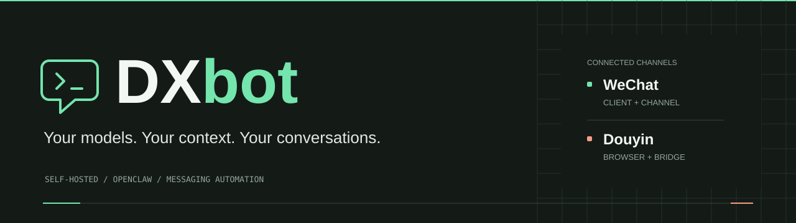
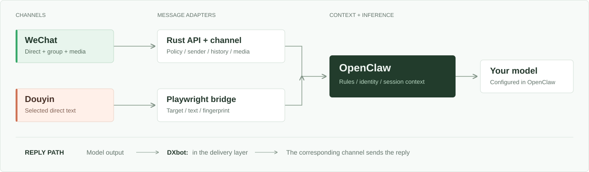

<p align="center">
  
</p>

<h3 align="center">把你的 AI 接入微信与抖音。</h3>

<p align="center">
  Self-hosted messaging automation, powered by OpenClaw.
</p>

<p align="center">
  <a href="https://github.com/ydxfkbg1630/DXbot/actions/workflows/release.yml"></a>
  <a href="https://github.com/ydxfkbg1630/DXbot/actions/workflows/douyin-test.yml"></a>
  <a href="https://github.com/ydxfkbg1630/DXbot/tree/main/packages/openclaw-extension"></a>
  <a href="LICENSING.md"></a>
</p>

<p align="center">
  <a href="#快速开始">快速开始</a> ·
  <a href="#平台能力">平台能力</a> ·
  <a href="#工作方式">工作方式</a> ·
  <a href="#文档导航">文档</a> ·
  <a href="#许可与来源">许可</a>
</p>

---

## DXbot 是什么

DXbot 把微信客户端自动化、抖音私信桥接和 OpenClaw 模型调用放进一套自托管工作流。你负责选择模型、配置会话策略与回复风格，DXbot 负责连接消息、上下文和发送过程。

项目面向个人服务器与自托管部署，提供 **Rust 微信服务、OpenClaw 微信扩展和 Python 抖音桥接**。配置、会话状态与部署数据由你管理。

| 消息接入 | 上下文与策略 | 回复与投递 |
|----------|--------------|------------|
| 微信私聊、群聊与媒体访问 | 发送者标签、白名单与群聊策略 | 发送层统一添加 `DXbot:` |
| 抖音指定好友私信文本 | OpenClaw 工作区规则与独立会话 | 微信多行回复逐条投递 |
| 微信消息水位与间隙补偿 | 微信历史上下文扩展与完整性校验 | 回复看门狗与发送进度记录 |

## 平台能力

| 能力 | 微信 | 抖音 |
|------|------|------|
| 接入形态 | Rust 服务 + OpenClaw 频道扩展 | Python + Playwright 独立桥接 |
| 会话范围 | 私聊与群聊 | 配置中指定的好友私信 |
| 文本自动回复 | 支持 | 支持 |
| 媒体处理 | 图片、语音、视频、表情与附件的获取和传递入口 | 随附定时发送引擎支持图片、原生表情 |
| 上下文 | 历史上下文接入、发送者信息、会话记忆 | 对方昵称、当前文本、独立模型会话 |
| 消息状态 | 聊天水位、指纹与间隙重试 | 指纹持久化与首次启动基线 |
| 发送标识 | `DXbot:` | `DXbot:` |

微信历史接入依赖部署环境的历史存储脚本，媒体理解取决于获取结果、OpenClaw 配置及模型能力。抖音桥接按页面可识别的最近一条对方文本轮询，适合低频私信。完整配置和配套要求见[部署指南](docs/DEPLOYMENT.md)与[抖音文档](integrations/douyin/README.md)。

## 工作方式

<picture>
  <source media="(prefers-color-scheme: dark)" srcset="assets/readme/architecture-dark.svg">
  
</picture>

微信扩展负责聊天策略、发送者标签、历史上下文和媒体路径。抖音桥接按好友生成独立的 ASCII 会话 ID，再调用 OpenClaw CLI。两条链路在各自发送入口添加 `DXbot:`，让接收者识别机器人回复。

<details>
<summary><strong>消息可靠性与实现位置</strong></summary>

| 模块 | 作用 |
|------|------|
| [`message-watermark.ts`](packages/openclaw-extension/src/message-watermark.ts) | 保存微信聊天水位与消息间隙重试状态 |
| [`poll-gate.ts`](packages/openclaw-extension/src/poll-gate.ts) | 按私聊、群聊、白名单和会话类型控制轮询 |
| [`reply-watchdog.ts`](packages/openclaw-extension/src/reply-watchdog.ts) | 管理回复超时、取消信号与空投递重试 |
| [`reply-sender.ts`](packages/openclaw-extension/src/reply-sender.ts) | 拆分多行回复、记录进度并添加发送标识 |
| [`wechat-history-context.ts`](packages/openclaw-extension/src/wechat-history-context.ts) | 对接历史存储脚本，校验数量、模式和哈希 |
| [`douyin_bridge.py`](integrations/douyin/app/douyin_bridge.py) | 定位好友、读取文本、调用 OpenClaw 并发送 |
| [`bridge_core.py`](integrations/douyin/app/bridge_core.py) | 生成消息指纹与提示文本，解析模型 JSON 回复 |

</details>

## 快速开始

### 1. 准备源码

微信服务部署面向具备 Docker 能力的 Linux 主机，Node.js 要求 **22+**，包管理器使用 **pnpm 9.15.4**。抖音桥接使用独立的 **Python 3.11+** 环境。

```bash
git clone https://github.com/ydxfkbg1630/DXbot.git
cd DXbot

corepack enable
corepack prepare pnpm@9.15.4 --activate
pnpm install --frozen-lockfile
pnpm build
```

### 2. 选择接入平台

**微信**

先按[源码部署指南](docs/DEPLOYMENT.md#docker-启动)构建镜像、对齐部署配套并完成客户端登录。将本仓库的微信扩展接入现有 OpenClaw：

```bash
openclaw plugins install -l ./packages/openclaw-extension
```

然后配置模型供应商、微信服务地址、认证令牌及会话策略。参数示例见 [OpenClaw 接入](docs/DEPLOYMENT.md#openclaw-接入)。

**抖音**

在已经配置好 OpenClaw 的主机上，准备独立桥接环境：

```bash
cd integrations/douyin
python3.12 -m venv .venv
.venv/bin/python -m pip install -r requirements.txt
.venv/bin/python -m playwright install --with-deps chromium

cp bridge.example.json bridge.json
cp .env.bridge.example .env.bridge
```

在桌面端通过 `scripts/login.py` 完成扫码，把生成的登录态传入服务器，填写目标好友及 OpenClaw 路径后启动：

```bash
.venv/bin/python -m app.douyin_bridge --config bridge.json --env-file .env.bridge
```

完整步骤见[抖音登录、配置与运行](integrations/douyin/README.md)。

## 文档导航

| 我想做什么 | 从这里开始 |
|------------|------------|
| 部署微信、对齐服务端配套、配置 OpenClaw | [部署与运维](docs/DEPLOYMENT.md) |
| 配置抖音监听目标、扫码登录、查看桥接日志 | [抖音私信桥接](integrations/douyin/README.md) |
| 使用命令行查询会话或发送消息 | [CLI 命令](docs/src/content/docs/getting-started/cli/commands.mdx) |
| 了解 REST 与 WebSocket 接口 | [API 参考](docs/src/content/docs/reference/api.mdx) |
| 管理认证、数据卷、远程访问和代理 | [运维文档](docs/src/content/docs/operations) |
| 排查登录、消息和客户端问题 | [故障排查](docs/src/content/docs/reference/troubleshooting.mdx) |
| 贡献代码、测试或文档 | [贡献说明](CONTRIBUTING.md) |

## 项目结构

```text
DXbot/
├── packages/
│   ├── agent-server-rust/    微信 UI 自动化、REST API 与媒体访问
│   ├── openclaw-extension/   微信频道、策略、上下文与回复流程
│   ├── cli/                  命令行客户端
│   ├── shared/               Rust / TypeScript 共享类型
│   ├── wechaty-gateway/      Wechaty 网关
│   └── wechaty-puppet/       Wechaty Puppet
├── integrations/douyin/     抖音桥接、定时发送引擎与测试
├── docker/                  微信客户端镜像与工具
├── docs/                    部署、架构与接口文档
└── scripts/                 构建、部署与类型生成
```

## 开发与验证

根据改动范围运行对应检查：

```bash
pnpm build
pnpm typecheck
pnpm -r --if-present test
```

Rust 服务和抖音桥接的测试命令见[开发与测试](docs/DEPLOYMENT.md#开发与测试)。抖音测试覆盖配置解析、好友定位、发送确认、消息指纹及模型回复解析；工作流结果可从页首徽章查看。

欢迎通过 [Issue](https://github.com/ydxfkbg1630/DXbot/issues) 提交复现与需求，通过 [Pull Request](https://github.com/ydxfkbg1630/DXbot/pulls) 参与改进。第三方代码请附上来源、版本和许可依据。

## 许可与来源

DXbot 在 [thisnick/agent-wechat](https://github.com/thisnick/agent-wechat) 的微信自动化基础上扩展；抖音发送引擎来自 [unmev/douyin-auto-fire](https://github.com/unmev/douyin-auto-fire)。感谢上游作者与贡献者。

本仓库采用**分范围许可**：维护者有权授权的 DXbot 原创贡献采用 **AGPL-3.0-only**；整个抖音目录维持 **PolyForm Noncommercial 1.0.0**。微信继承代码的完整授权范围仍需向上游权利人核实，第三方依赖和镜像组件按各自条款处理。

[许可范围](LICENSING.md) · [第三方声明](THIRD_PARTY_NOTICES.md) · [版权与署名](NOTICE.md) · [品牌使用](BRANDING.md)

Copyright (c) 2026 ydxfkbg1630，限 DXbot 原创贡献；各上游作者保留其作品版权。
